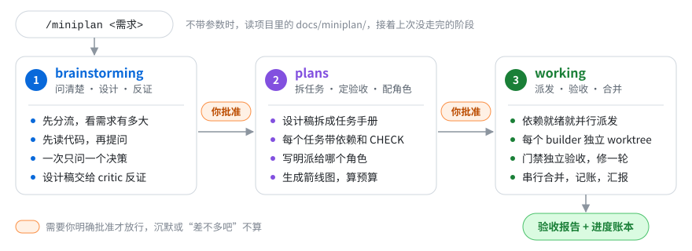
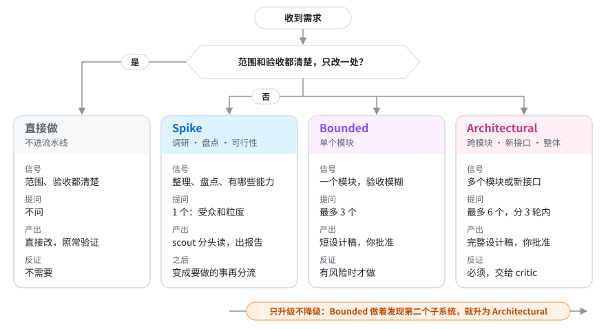
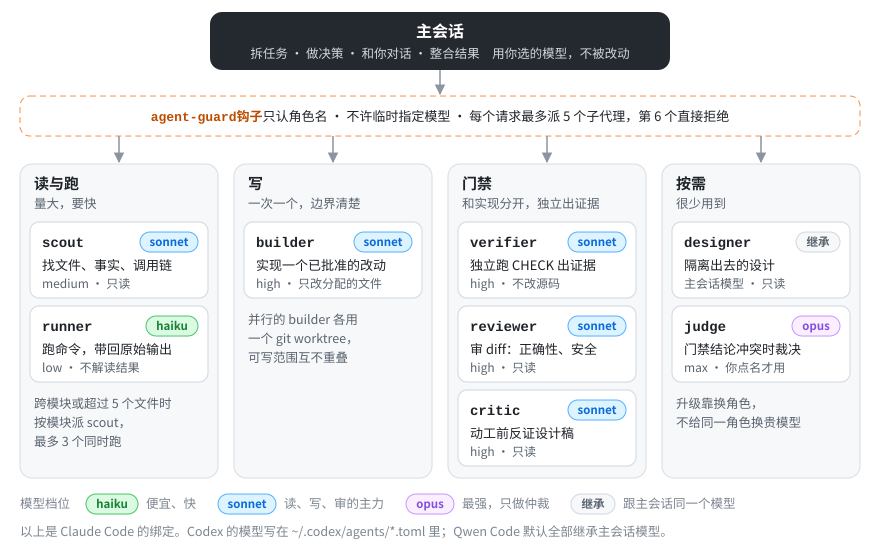
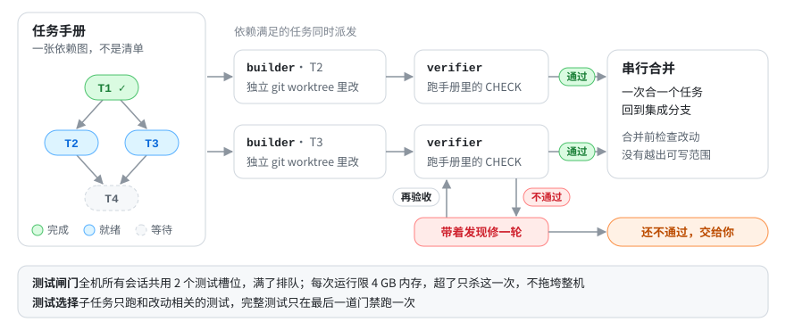

<div align="center">

# miniplan

**把范围大、目标模糊的需求，先问清楚，再设计、反证、规划、派发、验收。**

一套 skill，三个宿主：Claude Code · Codex · Qwen Code　｜　v0.3.0　｜　[CHANGELOG](CHANGELOG.md)

</div>



## 安装

需要 `bash`、`jq`、Python 3.11+；Codex 的脚本调度另需 Node.js 18+。Windows 原生请在 Git Bash 里用，并确保 `jq` 在 PATH 里。

> [!IMPORTANT]
> 每个工具只选一种装法：**原生市场**（只用不改）或 **clone + `install.sh`**（要改 skill）。两种都装，skill 和钩子会加载两次。装完或更新后要开新会话。

### Claude Code

```bash
claude plugin marketplace add biuayi/miniplan-skills
claude plugin install miniplan@miniplan-skills
```

验证：`claude plugin details miniplan` 应列出 5 个 skill、8 个 agent 和 hooks。
更新：`claude plugin marketplace update miniplan-skills && claude plugin update miniplan@miniplan-skills`

### Codex

```bash
codex plugin marketplace add biuayi/miniplan-skills
codex plugin add miniplan@miniplan-skills
```

Codex 插件只能带 skill 和钩子，角色文件、`AGENTS.md`、钩子信任和 `config.toml` 要手动处理一次，步骤见 [docs/install.md](docs/install.md#codex)。
更新：`codex plugin marketplace upgrade miniplan-skills`

### Qwen Code

```bash
qwen extensions install https://github.com/biuayi/miniplan-skills/archive/refs/heads/qwen-extension.tar.gz
```

> [!CAUTION]
> 不要写成 `https://github.com/biuayi/miniplan-skills --ref qwen-extension`。对 HTTPS 仓库地址 Qwen 会忽略 `--ref`，装成转换后的 Claude 版，角色和钩子不能正常工作。

更新：`qwen extensions update miniplan`

<details>
<summary><b>从本地 clone 安装（要改 skill 时用）</b></summary>

```bash
git clone https://github.com/biuayi/miniplan-skills.git ~/Project/miniplan-skills
cd ~/Project/miniplan-skills
./install.sh claude     # 或 codex、qwen、all
```

更新：Claude Code 只需 `git pull`，然后开新会话；Codex 和 Qwen Code 要 `git pull && ./install.sh <工具>`。

</details>

换装法、旧版残留、Codex 模型配置、Qwen 角色模型等注意事项见 [docs/install.md](docs/install.md)。

## 用法

| 场景 | Claude Code / Qwen Code | Codex |
| --- | --- | --- |
| 新需求 | `/miniplan 把 X 整体梳理一下` | `$miniplan 把 X 整体梳理一下` |
| 续跑上次没做完的 | `/miniplan` | `$miniplan` |
| 调研、盘点 | `/miniplan 整理一下 X 有哪些能力` | `$miniplan 整理一下 X 有哪些能力` |

设计稿、任务手册和进度账本都写在当前项目的 `docs/miniplan/` 下。

## 分流与路由

主会话只负责拆任务、做决策、和你对话、整合结果；读代码、跑命令、写代码、验收都交给职责单一的子代理。什么时候问你、什么时候派人、派谁、用什么模型，都由固定规则决定，不靠临场发挥。

### 需求分流：先判断需求有多大



- **先读再问**：scout 能从代码里查到的，不拿来问你。
- **一个问题一个决策**：每次最多问两个问题，每个问题 2 到 4 个选项，推荐项排第一并写明理由。答案记进设计稿的 Decisions。
- **反证**：critic 专门给设计稿挑错，每条意见都要引用证据。主会话逐条裁决：采纳、驳回，或者变成新问题交给你。
- **两道闸门**：设计稿和任务手册都要你明确批准，沉默不算批准。

### 角色路由：派发时选角色，模型跟着角色走



- **只在值得时派发**：有两条以上能并行的只读线、原始输出会塞满主会话上下文、需要独立门禁，或者你明确要求时才派子代理；否则主会话自己做。
- **按职责分档**：读和跑用便宜、快的模型，写和审用中档，最强的模型只用来仲裁，而且要你点名。
- **升级换角色，不换模型**：需要更严的把关就换 critic 或 judge，不给同一个角色换更贵的模型。
- **实现和验收分开**：builder 自己跑的测试不算验收。verifier 拿手册里的 CHECK 原文独立去跑；不通过修一轮，还不通过交给你。
- **预算**：对话里派发时，每个用户请求最多 5 个子代理，由钩子计数；按任务手册跑时，上限是你批准手册时同意的预算。

### 任务调度：手册是一张依赖图



plans 把设计稿拆成任务，每个任务写明依赖、可写范围（OWNS）、可执行的 CHECK 和派给哪个角色。working 照着这张图调度：哪个任务的依赖满足了就派哪个，可写范围不重叠的任务并行，每个 builder 在自己的 git worktree 里改，过了门禁再一个个合并回集成分支。Claude Code 和 Qwen Code 用原生 Workflow 脚本调度，Codex 通过 `codex exec` 接入同一个调度器。

## 更多文档

- [docs/install.md](docs/install.md)：两种装法的完整步骤，各工具的差异和注意事项
- [docs/workflow.md](docs/workflow.md)：预算放宽、Workflow 模式、测试闸门、Codex 脚本调度、`miniplan.py` 命令
- [docs/maintaining.md](docs/maintaining.md)：目录结构、构建、测试、发布、已知限制
- [docs/codex-workflow.md](docs/codex-workflow.md)：Codex 调度的实现核验
