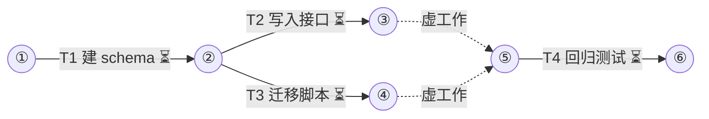

# <topic> 任务手册

设计稿：docs/miniplan/YYYY-MM-DD-<topic>-design.md（已批准 YYYY-MM-DD）
状态：草稿 | 已批准（YYYY-MM-DD）
集成分支：<branch>
并发：6
测试并发：3
预算：<N>（基础派发 + 修复余量；miniplan.py lint 给出基础派发）
工作树准备：<shell，可选，如 npm ci --prefer-offline>
槽位环境：<shell，可选，如 export APP_PORT=$((4300+10*MINIPLAN_SLOT))>
串行理由：<可选；任务数 N ≥ 4 且宽度为 1 时必填：为什么不能拆宽>

## 通用约束（每个子代理契约都带，按项目补充）
- 开发中只用项目的选测命令（如 `npm run test:affected`）跑与改动相关的检查；builder 不跑全量套件，全量只在合并前最终门禁由 verifier 跑一次，main 读其原始输出不重跑。
- 每完成一项独立改动就提交一次；只暂存自己 OWNS 的文件。
- 每份契约写 `BUDGET:`（默认值见 $miniplan-agents 的 Suggested Budgets）；到达即停，返回 partial 并说明还差什么。
- 产物（代码/注释/测试名/文件名/commit）不得出现 T<n>/P<n>/阶段号或计划文档章节引用。

## 箭线图


最长链：3 个任务（T1→T2→T4；等长另有 1 条），至少 3 层
状态：⏳未开始 🔄进行中 ✅完成 🔁返工 ❌失败（working 每次记账后同步刷新）

（本段由 `python3 -I ~/.codex/skills/miniplan-agents/bin/miniplan.py diagram --write <plan>` 按 DEPENDS 生成，不手画。示例只作格式参考；USES 同一资源的两个任务之间画 `-.->|"资源:<名>"|` 虚工作。）

## Tasks

（格式说明：角色只用 scout / runner / builder（每任务至多 1 个）/ verifier / reviewer / critic / main，designer 和 judge 不进手册；无 builder 的任务是门禁任务。非汇点任务的 CHECK 只用选测命令，全量套件只在汇点的门禁任务里跑。拆宽：B 只通过 A 的接口依赖 A 时，先拆出接口任务。）

T1 <title>
DEPENDS  none | T<k>, T<j>@<资源>
USES     <资源>, ...（可选；DEPENDS 里的 @<资源> 必须出现在某个任务的 USES 里）
REALIZES A1 | internal
GOAL     <one measurable outcome>
DELIVER  <path>, <path>; Consumes: <interface>  Produces: <interface + signature>
CHECK    <command>  → exit 0 且输出含 "<fragment>"（或：测试 <file>::<case> 通过）
         设计验收任务在此粘贴测试代码：
         ```<lang>
         <test body or assertion block>
         ```
AGENTS   builder OWNS: <逗号分隔的路径前缀或 glob，目录以 / 结尾> ; verifier read-only
PROMPT   builder:
         OBJECTIVE: ...
         SCOPE: ...
         CONTEXT: ...
         CONSTRAINTS: ... ; 产物(代码/注释/测试名/文件名/commit)不得出现 T<n>/P<n>/阶段号或计划文档章节引用
         ACCEPTANCE: <CHECK verbatim>
         OWNERSHIP: <OWNS>
         BUDGET: <工具调用数 / 墙钟分钟 / 截图数>
         RETURN: STATUS / SUMMARY / EVIDENCE / CHANGES / VALIDATION / RISKS / NEXT
         verifier:
         OBJECTIVE: Run the CHECK for T1 independently and report evidence.
         ...

T2 ...

## Progress
(working 追加：`T<n>: complete — <evidence>` / `T<n>: repair 1 — <finding>` / `T<n>: failed — <why>` / `Ruling: <decision> — <why> — <cost if wrong>`)
