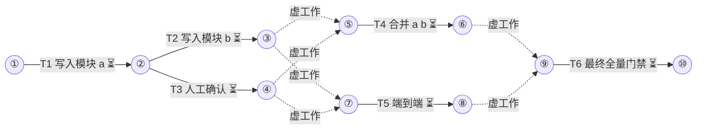

# good 手册

状态：已批准（2026-01-01）
集成分支：main
并发：6
测试并发：2
预算：20
工作树准备：true
槽位环境：export FIXTURE_PORT=$((5000+MINIPLAN_SLOT))

## 通用约束
- 仅用于解析器与 lint 测试的数据

## 箭线图

最长链：4 个任务（T1→T2→T4→T6；等长另有 3 条），至少 4 层
状态：⏳未开始 🔄进行中 ✅完成 🔁返工 ❌失败（working 每次记账后同步刷新）

## Tasks

T1 写入模块 a
DEPENDS  none
REALIZES internal
GOAL     src/a/a.txt 含一行 alpha
DELIVER  src/a/a.txt
CHECK    grep -qx alpha src/a/a.txt
AGENTS   builder OWNS: src/a/ ; verifier read-only
PROMPT   builder:
         OBJECTIVE: 在 src/a/a.txt 写入一行 alpha
         ACCEPTANCE: grep -qx alpha src/a/a.txt
         verifier:
         OBJECTIVE: 独立运行 CHECK 并报告证据
         ACCEPTANCE: grep -qx alpha src/a/a.txt
ROUND    r1

T2 写入模块 b
DEPENDS  T1
USES     e2e
REALIZES internal
GOAL     src/b/b.txt 含一行 beta
DELIVER  src/b/b.txt
CHECK    grep -qx beta src/b/b.txt
AGENTS   builder OWNS: src/b/ ; verifier read-only
PROMPT   builder:
         OBJECTIVE: 按 builder 角色完成本任务
         ACCEPTANCE: grep -qx beta src/b/b.txt
         verifier:
         OBJECTIVE: 按 verifier 角色完成本任务
         ACCEPTANCE: grep -qx beta src/b/b.txt
ROUND    r1

T3 人工确认
DEPENDS  T1
REALIZES internal
GOAL     用户确认模块 a 的结果
DELIVER  docs/confirm.txt
CHECK    grep -qx confirmed docs/confirm.txt
AGENTS   main
PROMPT   none
ROUND    r1

T4 合并 a b
DEPENDS  T2, T3
REALIZES internal
GOAL     src/c/c.txt 含一行 gamma
DELIVER  src/c/c.txt
         再写 docs/c.md 说明合并方式
CHECK    grep -qx gamma src/c/c.txt
AGENTS   scout read-only ; builder OWNS: src/c/, docs/c.md ; reviewer read-only
PROMPT   scout:
         OBJECTIVE: 按 scout 角色完成本任务
         ACCEPTANCE: grep -qx gamma src/c/c.txt
         builder:
         OBJECTIVE: 按 builder 角色完成本任务
         ACCEPTANCE: grep -qx gamma src/c/c.txt
         reviewer:
         OBJECTIVE: 按 reviewer 角色完成本任务
         ACCEPTANCE: grep -qx gamma src/c/c.txt
ROUND    r1

T5 端到端
DEPENDS  T3, T2@e2e
USES     e2e
REALIZES internal
GOAL     src/e/e.txt 含一行 epsilon
DELIVER  src/e/e.txt
CHECK    grep -qx epsilon src/e/e.txt
AGENTS   builder OWNS: src/e/** ; verifier read-only
PROMPT   builder:
         OBJECTIVE: 按 builder 角色完成本任务
         ACCEPTANCE: grep -qx epsilon src/e/e.txt
         verifier:
         OBJECTIVE: 按 verifier 角色完成本任务
         ACCEPTANCE: grep -qx epsilon src/e/e.txt
ROUND    r1

T6 最终全量门禁
DEPENDS  T4, T5
REALIZES internal
GOAL     全部产物在位
DELIVER  无新文件
CHECK    grep -qx alpha src/a/a.txt
AGENTS   verifier read-only
PROMPT   verifier:
         OBJECTIVE: 按 verifier 角色完成本任务
         ACCEPTANCE: grep -qx alpha src/a/a.txt
ROUND    r1

## Progress
