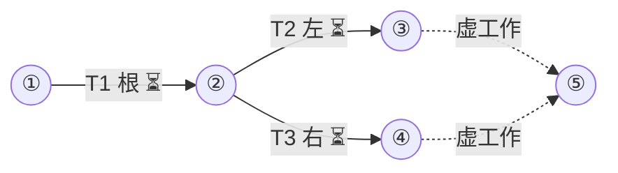

# sinks 手册

状态：已批准（2026-01-01）
集成分支：main
并发：6
测试并发：2
预算：20
工作树准备：true
槽位环境：export FIXTURE_PORT=$((5000+MINIPLAN_SLOT))

## 通用约束
- 仅用于解析器与 lint 测试的数据

## 箭线图

最长链：2 个任务（T1→T2；等长另有 1 条），至少 2 层
状态：⏳未开始 🔄进行中 ✅完成 🔁返工 ❌失败（working 每次记账后同步刷新）

## Tasks

T1 根
DEPENDS  none
REALIZES internal
GOAL     s1/x.txt 含一行 root
DELIVER  s1/x.txt
CHECK    grep -qx root s1/x.txt
AGENTS   builder OWNS: s1/ ; verifier read-only
PROMPT   builder:
         OBJECTIVE: 按 builder 角色完成本任务
         ACCEPTANCE: grep -qx root s1/x.txt
         verifier:
         OBJECTIVE: 按 verifier 角色完成本任务
         ACCEPTANCE: grep -qx root s1/x.txt
ROUND    r1

T2 左
DEPENDS  T1
REALIZES internal
GOAL     s2/x.txt 含一行 left
DELIVER  s2/x.txt
CHECK    grep -qx left s2/x.txt
AGENTS   builder OWNS: s2/ ; verifier read-only
PROMPT   builder:
         OBJECTIVE: 按 builder 角色完成本任务
         ACCEPTANCE: grep -qx left s2/x.txt
         verifier:
         OBJECTIVE: 按 verifier 角色完成本任务
         ACCEPTANCE: grep -qx left s2/x.txt
ROUND    r1

T3 右
DEPENDS  T1
REALIZES internal
GOAL     s3/x.txt 含一行 right
DELIVER  s3/x.txt
CHECK    grep -qx right s3/x.txt
AGENTS   builder OWNS: s3/ ; verifier read-only
PROMPT   builder:
         OBJECTIVE: 按 builder 角色完成本任务
         ACCEPTANCE: grep -qx right s3/x.txt
         verifier:
         OBJECTIVE: 按 verifier 角色完成本任务
         ACCEPTANCE: grep -qx right s3/x.txt
ROUND    r1

## Progress
